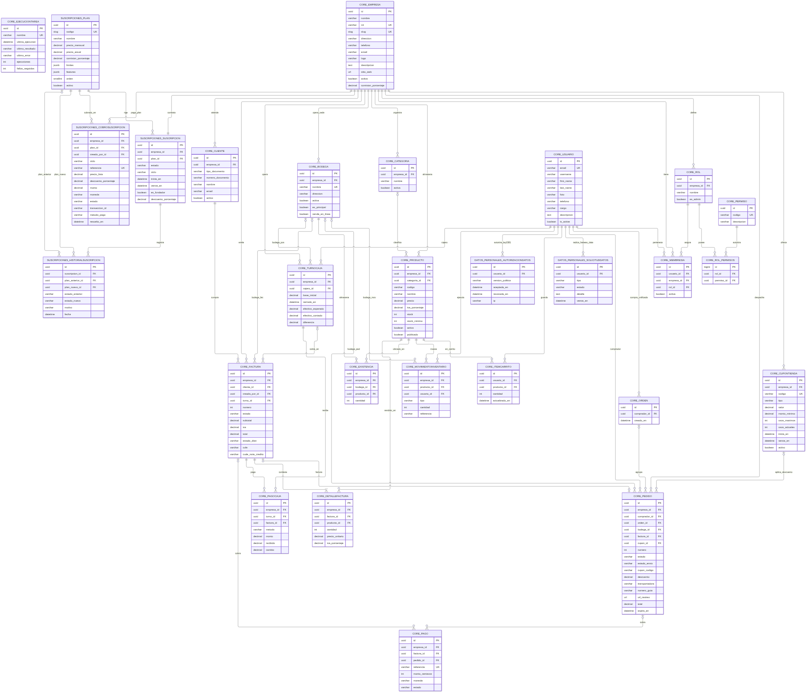

# Diagramas de Arquitectura y Diseño — InterSoft

Documentación visual de la arquitectura multi-tenant, base de datos PostgreSQL, casos de uso y flujos de secuencia de **InterSoft**.

## Tablero interactivo en Figma (FigJam)

- **[Abrir tablero editable en FigJam — InterSoft (MER, Casos de Uso y Secuencia)](https://www.figma.com/board/KMiHj4aDVj0bCFNxfUqoAw)**

## PDF completo con todos los diagramas renderizados

- **[InterSoft-Diagramas-Completos.pdf](InterSoft-Diagramas-Completos.pdf)** (13 diagramas visuales en alta resolución)

## Estructura de carpetas

- **MER — Modelo Entidad-Relación**:
  [Markdown](mer/modelo-entidad-relacion.md) · [PDF visual](mer/modelo-entidad-relacion.pdf) · [PNG](mer/img/modelo-entidad-relacion.png) · [SVG](mer/img/modelo-entidad-relacion.svg)
- **UML — Diagrama de Clases**:
  [Markdown](uml/diagrama-clases.md) · [PDF visual](uml/diagrama-clases.pdf) · [PNG](uml/img/diagrama-clases.png) · [SVG](uml/img/diagrama-clases.svg)
- **Casos de Uso (`CU-01` a `CU-25`)**:
  [Markdown](casos-de-uso/casos-de-uso.md) · [PDF visual](casos-de-uso/casos-de-uso.pdf) · [PNG](casos-de-uso/img/casos-de-uso.png) · [SVG](casos-de-uso/img/casos-de-uso.svg)
- **Diagramas de Secuencia (10 flujos)**:
  [Markdown](secuencia/diagramas-secuencia.md) · [PDF visual](secuencia/diagramas-secuencia.pdf) · Carpeta de imágenes: [`secuencia/img/`](secuencia/img/)
  1. [Compra en Marketplace, reserva de stock y webhook Wompi](secuencia/img/diagramas-secuencia-01.png)
  2. [Cambio de plan de suscripción y validación multi-tenant](secuencia/img/diagramas-secuencia-02.png)
  3. [Punto de Venta (POS), idempotencia y traslado a Tesorería](secuencia/img/diagramas-secuencia-03.png)
  4. [Facturación electrónica DIAN (`CUFE`), contabilidad PUC y Nota Crédito (`CUDE`)](secuencia/img/diagramas-secuencia-04.png)
  5. [Compra unificada en varios negocios (`Orden` + `Pedido`)](secuencia/img/diagramas-secuencia-05.png)
  6. [Pago de un plan con Wompi (retorno, webhook y conciliación)](secuencia/img/diagramas-secuencia-06.png)
  7. [Traslado entre bodegas](secuencia/img/diagramas-secuencia-07.png)
  8. [Venta POS desde una bodega](secuencia/img/diagramas-secuencia-08.png)
  9. [Tareas periódicas (`core/tareas.py` + `EjecucionTarea`)](secuencia/img/diagramas-secuencia-09.png)
  10. [Carrito multi-dispositivo, cupón de tienda y rastreo de envío](secuencia/img/diagramas-secuencia-10.png)

## Vista rápida — Modelo Entidad-Relación

