# Casos de Uso — InterSoft

Actores, roles del sistema, casos de uso por subsistema y especificación de flujos principales y excepciones.

```mermaid
flowchart LR
    subgraph Actores["Actores del Sistema"]
        ADM(("Administrador"))
        CAJ(("Cajero POS"))
        ASE(("Asesor Comercial"))
        BOD(("Bodega e Inventario"))
        CON(("Contador"))
        EMP(("Empleado"))
        COMP(("Comprador Web"))
        CRON(("Sistema / Cron"))
    end

    subgraph SubsistemaNegocio["Negocio, Equipo y Suscripciones"]
        UC_REG["CU-01: Registrar negocio (inicia Trial 14 días)"]
        UC_PER["CU-02: Editar perfil de usuario y perfil de negocio"]
        UC_EQU["CU-03: Gestionar roles y miembros del equipo"]
        UC_SUS["CU-04: Consultar y cambiar plan de suscripción"]
        UC_PAG_CFG["CU-05: Configurar credenciales de pago propias"]
    end

    subgraph SubsistemaComercial["Ventas, POS y Marketplace"]
        UC_POS["CU-06: Abrir caja, vender en POS y cerrar arqueo"]
        UC_FAC["CU-07: Crear, cobrar (Wompi) o anular factura"]
        UC_CAT["CU-08: Explorar Marketplace, carrito y checkout"]
        UC_UNIF["CU-18: Compra unificada en varios negocios (Orden)"]
        UC_PLAN_WOMPI["CU-19: Pagar plan de suscripción con Wompi"]
        UC_DESP["CU-09: Gestionar despacho y guía de pedidos web"]
        UC_REEM["CU-10: Registrar reembolso y dispersión de pedido"]
    end

    subgraph SubsistemaERP["Inventario, Bodegas, ERP, DIAN y Contabilidad"]
        UC_INV["CU-11: Gestionar productos, categorías y kardex"]
        UC_TRAS["CU-20: Gestionar bodegas y trasladar stock entre sedes"]
        UC_POS_BOD["CU-21: Vender en POS descontando de la bodega del turno"]
        UC_COMP["CU-12: Registrar y recibir compras / producción"]
        UC_DIAN["CU-13: Emitir factura electrónica (CUFE) y Nota Crédito (CUDE)"]
        UC_CONT["CU-14: Contabilizar en 1 clic (PUC) y gestionar cartera/tesorería"]
        UC_NOM["CU-15: Liquidar aportes de ley y aprobar nómina"]
    end

    subgraph SubsistemaAuto["Procesos Automáticos"]
        UC_VENC_PED["CU-16: Liberar reservas de pedidos vencidos y alertar stock"]
        UC_VENC_SUS["CU-17: Vencer Trials/Suscripciones y pasar a plan Gratis"]
        UC_TAREAS["CU-22: Ejecutar tareas periódicas con bloqueo EjecucionTarea"]
    end

    ADM --> UC_REG
    ADM --> UC_PER
    ADM --> UC_EQU
    ADM --> UC_SUS
    ADM --> UC_PLAN_WOMPI
    ADM --> UC_PAG_CFG
    ADM --> UC_REEM

    CAJ --> UC_PER
    CAJ --> UC_POS
    CAJ --> UC_POS_BOD

    ASE --> UC_PER
    ASE --> UC_FAC
    ASE --> UC_DIAN

    BOD --> UC_PER
    BOD --> UC_INV
    BOD --> UC_TRAS
    BOD --> UC_COMP
    BOD --> UC_DESP

    CON --> UC_PER
    CON --> UC_DIAN
    CON --> UC_CONT
    CON --> UC_NOM

    EMP --> UC_PER
    EMP --> UC_INV

    COMP --> UC_PER
    COMP --> UC_CAT
    COMP --> UC_UNIF

    CRON --> UC_VENC_PED
    CRON --> UC_VENC_SUS
    CRON --> UC_TAREAS
```

## Especificación de Casos de Uso Principales

| Código | Caso de Uso | Actor Principal | Precondición | Flujo Principal | Flujo de Excepción |
| :--- | :--- | :--- | :--- | :--- | :--- |
| **CU-01** | Registrar negocio | Usuario autenticado | Correo verificado | Crea la empresa, rol Admin, roles base y suscripción `TRIAL` de 14 días en plan Negocio. | Si faltan dirección o teléfono para Marketplace, bloquea la publicación pública (Ley 1480). |
| **CU-04** | Cambiar plan de suscripción | Administrador | Empresa activa | Selecciona plan y ciclo (`MENSUAL`/`ANUAL`), valida límites, aplica descuento fundador (primeros 50 pagos) y registra en historial. | Si el uso actual supera el límite del plan destino, rechaza el downgrade indicando cuánto debe reducir (`DowngradeNoPermitido`). |
| **CU-06** | Vender en POS y cerrar caja | Cajero POS | Turno de caja abierto | Escanea productos, cobra con efectivo/tarjeta/transferencia, descuenta stock, emite ticket y cierra caja con arqueo a ciegas. | Stock insuficiente o doble clic → transacción revertida o protegida por idempotencia (`operacion_pos`). |
| **CU-08** | Checkout y pago en Marketplace | Comprador Web | Carrito con stock | Reserva inventario por 30 min, crea pedido, redirige a Wompi y al aprobarse el webhook genera factura y notifica por correo. | Si expira el plazo sin pago o el webhook trae monto adulterado, libera stock o marca `REQUIERE_REEMBOLSO` con alerta `CRITICAL`. |
| **CU-13** | Facturación electrónica DIAN | Asesor / Contador | Factura emitida > $0 | Envía al adaptador DIAN para generar `CUFE`, XML y PDF; si luego se anula, emite automáticamente Nota Crédito (`CUDE`) + reversión contable. | Si la factura ya fue anulada o tiene total `0`, rechaza la emisión ante la DIAN. |
| **CU-14** | Contabilización y Cartera | Contador | Documento confirmado | En 1 clic genera asientos PUC en partida doble (`FACT-n`, `REC-FACT-n`, `COMP-n`, `TES-n`, `NOM-n`) o traslada efectivo de cierre POS a tesorería. | Asiento descuadrado (`débito ≠ crédito`) o abono superior al saldo → bloqueado con `ValidationError`. |
| **CU-16 / 17** | Tareas automáticas de vencimiento | Sistema / Cron | Plazo expirado | `procesar_reservas_y_alertas` devuelve stock de pedidos vencidos y alerta stock mínimo; `verificar_suscripciones` pasa Trials vencidos a plan `Gratis`. | Si Wompi confirma pago de último segundo antes de liberar, respeta el pago sin liberar stock. |
| **CU-18** | Compra unificada en varios negocios | Comprador Web | Carrito con ítems de 2+ empresas | Un solo checkout (`/comprar/`) crea una `Orden` y un `Pedido` independiente por cada negocio, reservando en la bodega en línea de cada uno; luego el comprador paga cada negocio por separado desde `/compras/<id>/`. | Si un producto no tiene existencia suficiente en la bodega en línea de ese negocio, revierte la transacción sin crear pedidos parciales. |
| **CU-19** | Pagar plan de suscripción con Wompi | Administrador | Plan pago elegido | `cobros.iniciar_cobro` congela precio/descuento fundador en `CobroSuscripcion` y redirige a Wompi; al volver, recibir webhook o conciliar, `aplicar_transaccion` llama `cambiar_plan`. | Si el monto o moneda difieren o hay `DowngradeNoPermitido`, marca `requiere_revision` sin activar el plan. |
| **CU-20** | Traslado entre bodegas | Bodega e Inventario | Plan con `multisede` y ≥2 bodegas activas | `bodegas.trasladar` bloquea existencias, resta en bodega origen, suma en bodega destino y registra `MovimientoInventario(TRASLADO)`. | Si origen = destino o falta stock en origen, lanza error sin alterar `Producto.stock`. |
| **CU-21** | Venta POS desde una bodega | Cajero POS | Turno abierto con bodega elegida | El turno fija `TurnoCaja.bodega`; cada venta registra `Factura.bodega` y descuenta `Existencia` de esa bodega específica. | Si esa bodega no tiene existencias suficientes (aunque otras sedes sí), bloquea la venta (`StockInsuficiente`). |
| **CU-22** | Tareas periódicas | Sistema / Cron | Scheduler activo (`tareas_periodicas`) | Reclama turno atómicamente en `EjecucionTarea`, ejecuta `liberar_pedidos_vencidos`, `verificar_suscripciones`, `conciliar_cobros_suscripcion` y `procesar_reservas_y_alertas`. | Si una tarea falla, incrementa `fallos_seguidos` y registra `ultimo_error` sin detener las demás. |
