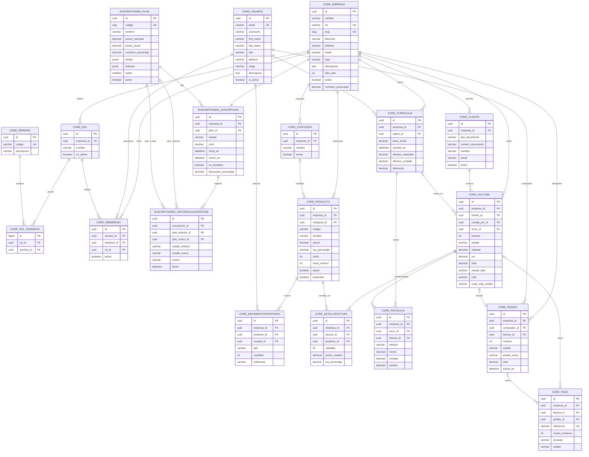

# Modelo Entidad–Relación (MER) — InterSoft

Estructura relacional de las tablas principales en PostgreSQL, incluyendo llaves primarias (`PK`), llaves foráneas (`FK`), llaves únicas (`UK`) y cardinalidades.

