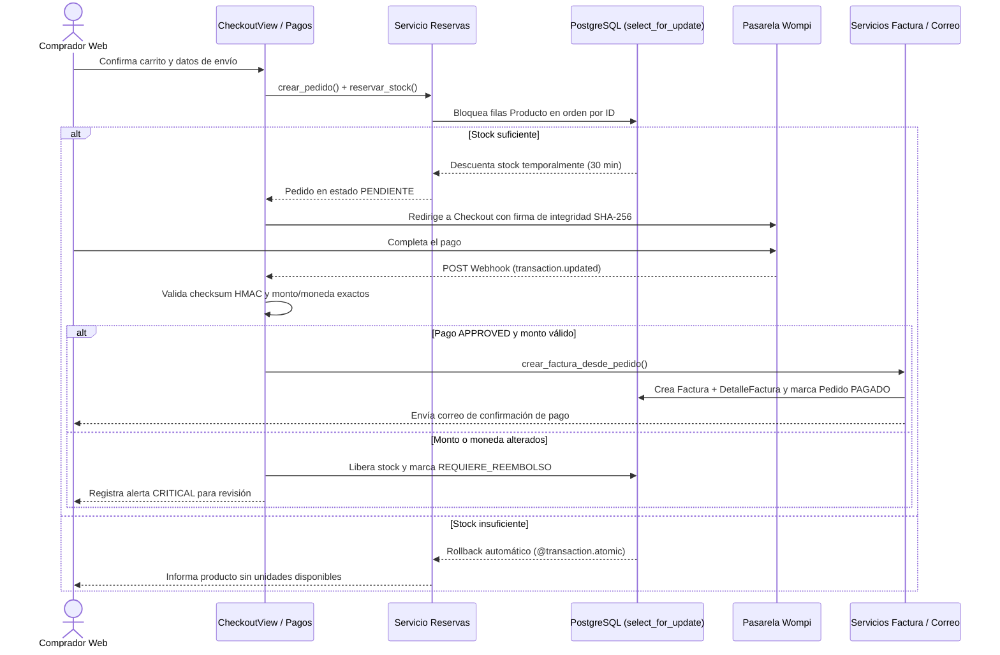
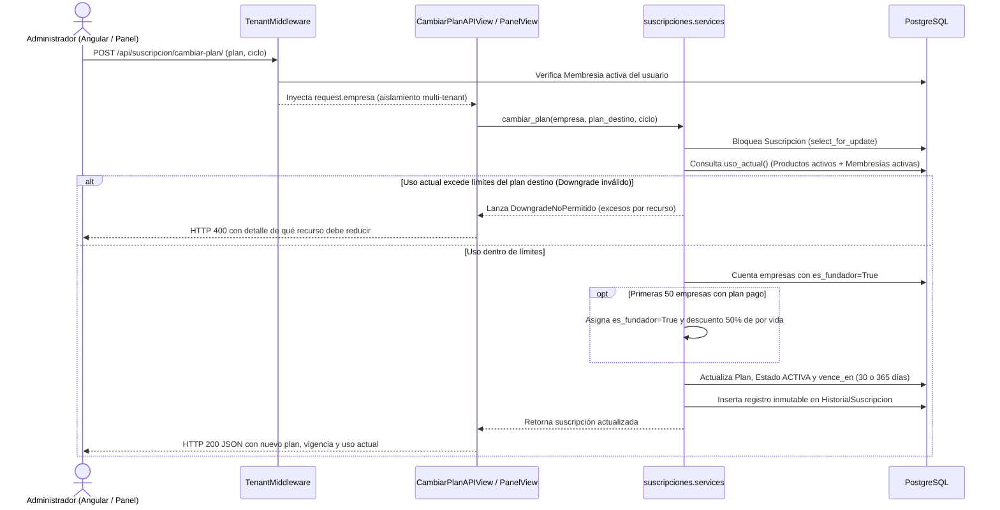
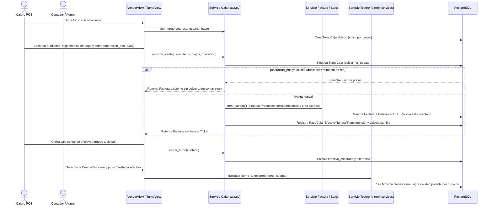
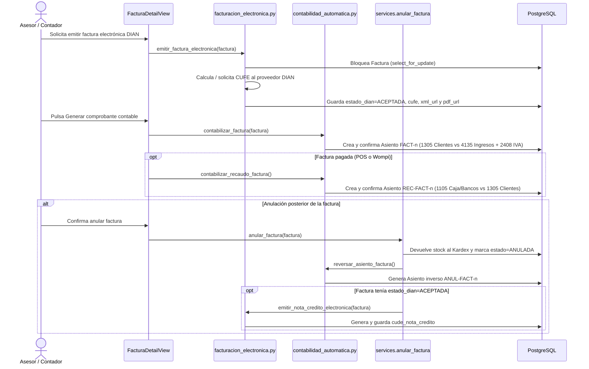

# Diagramas de Secuencia — InterSoft

Flujos detallados de interacción entre actores, vistas, servicios transaccionales y base de datos PostgreSQL.

## 1. Compra en Marketplace, Reserva de Stock y Pago Wompi

## 2. Cambio de Plan de Suscripción y Validación Multi-tenant

## 3. Punto de Venta (POS), Idempotencia y Traslado a Tesorería

## 4. Facturación Electrónica DIAN, Contabilidad PUC y Anulación (CUDE)

